# Choices: trex tong-transfer → AgenticWAM

## Conversion (DATA.md step 1) — `utils/convert_trex_v30_to_v21.py`
- Source `data_local/trex_gateway_tong_transfer_sf_norawtac_20260820` (LeRobot v3.0) → output `trex_tong_transfer_aw76_v21` (v2.1, 1 shard, 200 episodes, 208,581 frames)
- cam_high = head_left: crop rows 0–280, cols 140–540 (280×400, the 224:320 aspect ratio), then resize to 224×320 (INTER_AREA)
- Wrist cameras: full frame resized to 224×320, no crop
- State/action: raw 76-D Tianji+Sharpa layout; arm poses from FK using T-Rex `VegaFK` (vega_1 URDF, L_ee/R_ee frames), torso fixed at (0.9, 1.57, 0.1), head at (0.28, 0, 0)
- tactile_force is not in the training view
- Small pilot first, then the full run on r6000

## Stats and embeddings (steps 2–4), on r6000
- Only GPUs 4–5 may be used
- `dataset_stats_eef64.json` via `utils/make_stats.py --transform tianji_sharpa` (stride 5, horizon 32)
- Cosmos-Reason1-7B instruction embeddings, max-len 128

## Code annotation (step 5)
- Route A, embodiment `tianji_sharpa`, frozen `ego` skill library (not modified)
- VLM: `gcp/google/gemini-3.1-pro-preview` at `https://inference-api.nvidia.com/v1/chat/completions` (config `codegen/pretrain/pipeline/configs/tianji_sharpa.yaml`, tag v1)
- Key: `~/agentic-wam/API-key.txt` holds `api: <key>`. Strip the `api: ` label before use; the file is chmod 600 and gitignored, and the key is passed only as `VLM_API_KEY`
- Labeling view `top` stream: head_left at full 360×640, no crop; tactile and wrist EEF in its state
- Free tactile dry run on all 200 episodes → paid 5-episode pilot → you approve → full 200
- After the pilot (matched_raw 0.40): run all 200 episodes unchanged at the default 8 s max span (`trex_tong_transfer_aw76_label`), then a second full run with a **15 s max span** (`--max-span-s 15`, view `trex_tong_transfer_aw76_label_s15`, which symlinks the same data); compare the two in an HTML page
- The proposed fixes (C1 cut offset, C3/C4 tool-aware prompts) are not applied
- Results (2026-10-23), 200/200 episodes for both: 8 s has 1167 slices, matched_raw 0.188, repaired 0.336; 15 s has 856 slices, matched_raw 0.176, repaired 0.345. On slices with a tactile event, matched_raw is 0.105 at 8 s and 0.287 at 15 s
- **Cache built from the 15 s run** (chosen 2026-10-23): `trex_tong_transfer_aw76_v21/policy_code_idx_trex_v1.pt` with `episode_order.json` beside it; 200 episodes, 208,581 frames, 402 codes, 0 missing. Comments are kept verbatim (no `--strip-comments`). `verify` reports ALIGNED
- **Cache id-0 fix** (2026-10-23): `codegen/posttrain/build_flat_code_cache.py` gave the first real block (`robot.pick('tong', 'right')`) id 0. The repo reads id 0 as "no code" (pretraining's builder reserves it for `""`), so `dump_code_gt.py` and `preflight_sft.py` reported 25,203 frames without code, and `merge_datasets.py` would fail its assert. Id 0 is now reserved for `""`, and I rebuilt the cache on r6000: 403 entries (402 codes plus the empty one), 0 frames on id 0. The code for every frame is identical to the old cache, `verify` reports ALIGNED, and the dump shows 0 frames with NO code. The old cache is kept at `data_local/annot_scratch/policy_code_idx_trex_v1.old.pt`. The old lines are left commented:

```diff
diff --git a/codegen/posttrain/build_flat_code_cache.py b/codegen/posttrain/build_flat_code_cache.py
index b85ef18..f6441c2 100644
--- a/codegen/posttrain/build_flat_code_cache.py
+++ b/codegen/posttrain/build_flat_code_cache.py
@@ -48,8 +48,13 @@ def _canonical(block, strip_comments):
 def assemble_flat_cache(per_episode_frame_codes, strip_comments=False):
     """episodes' per-frame block strings -> {codes(unique), code_id_by_idx(int32)}. Dedups by the
     (optionally comment-normalized) string."""
-    codes: list[str] = []
-    index: dict[str, int] = {}
+    # codes: list[str] = []
+    # index: dict[str, int] = {}
+    # Reserve id 0 for "" (no code), the convention of codegen/pretrain/build_code_cache_flat.py that
+    # dump_code_gt / preflight_sft / merge_datasets / build_subgoal_from_code read as "empty". Without
+    # it the first real block got id 0 and those tools reported it as missing.
+    codes: list[str] = [""]
+    index: dict[str, int] = {"": 0}
     ids: list[int] = []
     EMPTY = "def policy_chunk(obs, state, robot, skills):\n    return skills.visual_diff(obs, obs)\n"
     for frames in per_episode_frame_codes:
```
- Code length in SDAR-1.7B tokens: max 156; per frame p50 49, p95 118, p99 144
- `model.infer_code_tokens=128` (chosen; truncates about 3% of frames, 18 of 402 codes). Training and serving must use the same value

## Post-training setup
- Frozen weights on r6000: Wan2.2 VAE at `~/models/Wan2.2-TI2V-5B/Wan2.2_VAE.pth`, Qwen3-VL-2B-Instruct at `~/models/Qwen3-VL-2B-Instruct` (the vision tower; the checkpoint holds only its merger)
- SDAR-1.7B weights are **not downloaded**: the pretrained checkpoint holds every code-expert tensor. `paths.code_model` points to `~/models/SDAR-1.7B-Chat-tok` (config, tokenizer and model code only), and the SDAR body is built from config when that folder has no weights. A folder with weights still loads them, so pretraining from scratch is unchanged (it has no AgenticWAM checkpoint to supply the code expert). The old lines are left commented:

```diff
diff --git a/src/agenticwam/models/experts/code_expert.py b/src/agenticwam/models/experts/code_expert.py
index f8b02f2..5820734 100644
--- a/src/agenticwam/models/experts/code_expert.py
+++ b/src/agenticwam/models/experts/code_expert.py
@@ -659,10 +659,28 @@ def _build_sdar_code_expert(
     so map model.layers -> MoT CodeBlocks exactly as the Qwen builder, keep SDAR's embed/lm_head/
     norm + its native <|MASK|> token, and set code_objective='blockdiff'. Vision reaches the code
     via MoT joint attention (code->video), so no vision encoder is needed here."""
-    from transformers import AutoModelForCausalLM, AutoTokenizer
-    logger.info("Loading SDAR code-expert backbone %s ...", model_name)
-    model = AutoModelForCausalLM.from_pretrained(
-        model_name, trust_remote_code=True, torch_dtype=torch_dtype, attn_implementation="sdpa")
+    # from transformers import AutoModelForCausalLM, AutoTokenizer
+    # logger.info("Loading SDAR code-expert backbone %s ...", model_name)
+    # model = AutoModelForCausalLM.from_pretrained(
+    #     model_name, trust_remote_code=True, torch_dtype=torch_dtype, attn_implementation="sdpa")
+    # Load SDAR's weights when `model_name` has them (pretraining from scratch needs them: no AgenticWAM
+    # checkpoint initialises the code expert). A config-only dir (config + tokenizer + modeling code) builds a
+    # random-init body instead -- only valid when foundation_ckpt then overwrites every code-expert tensor
+    # (post-training).
+    import glob, os
+    from transformers import AutoConfig, AutoModelForCausalLM, AutoTokenizer
+    has_weights = bool(glob.glob(os.path.join(str(model_name), "*.safetensors"))
+                       or glob.glob(os.path.join(str(model_name), "pytorch_model*.bin")))
+    if has_weights or not os.path.isdir(str(model_name)):
+        logger.info("Loading SDAR code-expert backbone %s ...", model_name)
+        model = AutoModelForCausalLM.from_pretrained(
+            model_name, trust_remote_code=True, torch_dtype=torch_dtype, attn_implementation="sdpa")
+    else:
+        logger.warning("SDAR dir %s has no weights: building the code-expert body from config (random init); "
+                       "foundation_ckpt must supply every code-expert tensor", model_name)
+        cfg = AutoConfig.from_pretrained(model_name, trust_remote_code=True)
+        model = AutoModelForCausalLM.from_config(
+            cfg, trust_remote_code=True, torch_dtype=torch_dtype, attn_implementation="sdpa")
     text_model = model.model
     qwen_layers = text_model.layers
     hidden_dim = qwen_layers[0].self_attn.q_proj.in_features
```
- Check: built from config, the SDAR expert has 456 tensors, and the checkpoint's `dit.mot.experts.code.*` has the same 456. None are missing or unexpected and no shapes differ, so no random init survives
- Paths: `configs/paths/r6000.yaml` (select it with `paths=r6000`)
- Environment (`~/venvs/agenticwam-data`): installed the `pyproject.toml` pins (torch, torchvision and transformers were already installed and unchanged), plus `flash-attn==2.8.3` (prebuilt cu12 torch2.7 cxx11abiTRUE cp310 wheel). SDAR's `SDARRMSNorm` calls flash-attn's Triton `rms_norm_fn`, so it is required either way
- SDAR model-code fix (in `~/models/SDAR-1.7B-Chat-tok/modeling_sdar.py`, a downloaded file, not repo code; the original is in `modeling_sdar.py.orig`). transformers 4.57 renamed `LossKwargs` to `TransformersKwargs`. The original line is left commented:

```diff
-from transformers.utils import LossKwargs, auto_docstring, can_return_tuple, is_torch_flex_attn_available, logging
+# from transformers.utils import LossKwargs, auto_docstring, can_return_tuple, is_torch_flex_attn_available, logging
+# transformers>=4.57 renamed LossKwargs -> TransformersKwargs (used only as a TypedDict base below)
+from transformers.utils import auto_docstring, can_return_tuple, is_torch_flex_attn_available, logging
+try:
+    from transformers.utils import LossKwargs
+except ImportError:
+    from transformers.utils import TransformersKwargs as LossKwargs
```

## Post-training environment setup (`~/venvs/agenticwam-data`)
Python 3.10.22, built with uv 0.13.4. The exact package versions are in `configs/env/agenticwam-data.freeze.txt` (110 packages).
```bash
# uv (skip if installed): curl -LsSf https://astral.sh/uv/install.sh | sh
cd ~/agentic-wam
~/.local/bin/uv venv --python 3.10 ~/venvs/agenticwam-data
PY=~/venvs/agenticwam-data/bin/python
# repo + pinned deps (torch 2.7.1+cu128, torchvision 0.22.1+cu128, transformers 4.57.x, deepspeed 0.18.5, ...)
~/.local/bin/uv pip install --python $PY --extra-index-url https://download.pytorch.org/whl/cu128 \
  --index-strategy unsafe-best-match -e .
# flash-attn: required by SDAR's RMSNorm (prebuilt wheel for torch 2.7 / cu12 / cxx11abi TRUE / cp310)
~/.local/bin/uv pip install --python $PY \
  "flash_attn @ https://github.com/Dao-AILab/flash-attention/releases/download/v2.8.3/flash_attn-2.8.3+cu12torch2.7cxx11abiTRUE-cp310-cp310-linux_x86_64.whl"
# or reproduce the exact versions instead of the two installs above:
#   ~/.local/bin/uv pip install --python $PY --extra-index-url https://download.pytorch.org/whl/cu128 \
#     --index-strategy unsafe-best-match -r configs/env/agenticwam-data.freeze.txt && ~/.local/bin/uv pip install --python $PY --no-deps -e .
# check
$PY -c "import torch, transformers, flash_attn, deepspeed; print(torch.__version__, transformers.__version__, flash_attn.__version__, deepspeed.__version__, torch.cuda.is_available())"
```
The SDAR `LossKwargs` patch to `modeling_sdar.py` (above) is also needed, and the transfer tar already includes the patched file.

## Post-training command (r6000)
Fill in your wandb key (https://wandb.ai/authorize) on r6000 only. Do not commit or copy this file once the key is filled in.
```bash
export WANDB_API_KEY=""          # <- paste your wandb API key between the quotes
cd ~/agentic-wam
D=$PWD/data_local/trex_tong_transfer_aw76_v21
SKIP_PREFLIGHT=1 CUDA_VISIBLE_DEVICES=0,1,2,3,4,5,6,7 NPROC=8 PYTHON=$HOME/venvs/agenticwam-data/bin/python \
bash scripts/train_real_sharpa.sh $D $D/policy_code_idx_trex_v1.pt paths=r6000 model.infer_code_tokens=128 \
  num_epochs=1 data.train.episode_indices=$D/episodes_0_99.json \
  data.val.episode_indices=$D/episodes_100_199.json \
  max_steps=20000 save_every=5000 eval_every=1000
```
Create the eval episode list once before launching: `python3 -c "import json; json.dump(list(range(100,200)), open('$D/episodes_100_199.json','w'))"`
- 8 GPUs (2026-10-24): 4 per GPU, global batch 32, `learning_rate` unchanged at 1e-4
- `max_steps=null` removed (2026-10-24): the length is the task config's `max_steps: 100000`, and `num_epochs=1` is ignored while `max_steps` is set (`trainer.py` `_estimate_total_train_steps`)
- Run length and cadence (2026-10-29): `max_steps=20000`, `save_every=5000` (checkpoints at 5k/10k/15k/20k; task default 20000), `eval_every=1000` (task default 2000)
- Overfitting (2026-10-29): 20000 steps overfits heavily, so do not treat the step-20k checkpoint as the default pick. Choose the checkpoint from the `eval_every=1000` val curve on episodes 100-199, and prefer an earlier save (5k/10k/15k) where val loss bottoms out
- Eval split (2026-10-29): `data.val.episode_indices` = episodes 100-199, disjoint from the 0-99 training episodes. Out-of-range indices are silently dropped, so check the `Using explicit episode_indices` log line for the loaded count


Step-20000 server replay plot: see "Server + client replay across checkpoints (2026-10-30)" at the end of this file.

## Deployment on vega + Sharpa (2026-10-24)
Branch `worktree-vega-sharpa-deploy`, commits `5b096b5`, `1958079`, `05c8697` (not pushed). Serve with `deploy/remote/server.py` through `deploy/launch_server.sh`. The older `deploy/deploy_server.py` stays YAM-only.
- **Opt-in flag**: Sharpa behaviour turns on only with `--embodiment sharpa` (`EMBODIMENT=sharpa` in `launch_server.sh`). The default `yam` works as before, and the flag is never inferred from the task. The server refuses to start if the flag and the task's transform disagree (`sharpa` needs `TianjiSharpaUnifiedEEFTransform`, `yam` needs `YamUnifiedEEFTransform`), or if `sharpa` is given a checkpoint that is not 64-D
- **Cameras** (`deploy/common/sharpa_obs.py`): the conversion recipe, byte-identical (pixel test). Head 360×640 → crop rows 0–280, cols 140–540 → 224×320 (INTER_AREA). Wrists: full 360×640 → 224×320 (INTER_AREA), no crop. Wire keys: `head_camera` = cam_high, `left_camera` = cam_left_wrist, `right_camera` = cam_right_wrist
- The generic stages that still run afterwards (`deploy_policy._build_obs_video`) leave these frames unchanged under the default `AGENTICWAM_EVAL_PREPROC=parity` and under `legacy` (measured difference 0). `parity_crop` would crop them again, so the server refuses it with `--embodiment sharpa`
- **Resolution check** (`deploy/common/resolution_guard.py`): every `/act` frame must be exactly 640×360 (W×H) RGB. Otherwise the server returns HTTP 400 naming the camera, the size received and the likely cause (rescaled, W/H swapped, RGBA, grayscale, other aspect ratio). Nothing is rescaled on the server. `/health` → `camera_resolution` shows the last size seen per camera and the number rejected
- **State/action** (`deploy/common/vega_eef64.py`): the robot sends 58-D `[L arm 7, L hand 22, R arm 7, R hand 22]` (the layout of the source `observation.state`/`action`) and gets back an absolute 58-D chunk in the same layout
  - In: FK → raw 76-D, the same layout as `pack76` in the converter
  - Out: the model's 64-D delta → `TianjiSharpaUnifiedEEFTransform.backward` (reused, not rewritten) → IK row by row, each seeded with the previous row. Hands pass through as absolute values, and the zero gripper dims are dropped
  - A row whose IK misses 1 mm is still used but counted as `ik_failures` in `/health`
- **Kinematics** (`utils/vega_fk_ik/vega_kinematics.py`, copied from T-Rex, so no T-Rex checkout is needed at run time)
  - FK = `VegaFK` (`utils/unpack_lerobot_to_raw_fk.py`). IK = `PinkLocalIK` + `build_reduced_bimanual_robot` (`hardware_code/teleop/`), with the same costs, 5 iterations and the daqp solver. Both arms are solved together, as upstream
  - Torso (0.9, 1.57, 0.1), head (0.28, 0, 0). The IK posture target is the teleop home pose from `hardware_code/config/default.yaml`: L `[0.84, 0.51, 0.37, -1.30, -0.65, -0.29, -0.03]`, R `[-0.84, -0.51, -0.37, -1.30, 0.65, 0.29, 0.03]`
  - `urdf/vega_1.urdf` is byte-identical to the conversion and teleop URDFs (Apache-2.0 license copied beside it). Only the kinematic tree is loaded: no meshes and no collision model (upstream IK does not use one either)
- `deploy/common/policy_runtime.py`: the old "`YamUnifiedEEFTransform` or `NotImplementedError`" block was **replaced, not left commented**; see `git diff main..worktree-vega-sharpa-deploy -- deploy/common/policy_runtime.py`. `deploy/remote/server.py` and `deploy/launch_server.sh` only gained the flag
- Not supported for Sharpa: real-time chunking (`committed`/`freeze` are ignored)
- Extra packages for the deploy venv (from T-Rex `hardware_code/requirements.txt`): `pin>=3.2`, `pin-pink`, `qpsolvers`, `daqp`
- Checked on the laptop: camera crop byte-identical; generic stages are a no-op; bridge tensor shapes and hand pass-through (with stubbed kinematics); resolution check (1 accepted, 6 rejected cases). **Not yet run**: the real FK/IK (pinocchio/pink are not installed there). Before the robot, run `python utils/vega_fk_ik/vega_kinematics.py` (FK→IK round trip) and a smoke start with a nonexistent `CKPT` in the deploy venv

## Deployment command (template)
Superseded for the tong-transfer checkpoint by `deploy/setup_server_env_sharpa.sh` + `deploy/launch_server_sharpa.sh` (see "How to run the deployment" below). Kept for reference.
`INFER_CODE_TOKENS` must be 128, as in training (the `launch_server.sh` default is 64). `INSTR` should be the dataset's task string. Do not commit the token.
```bash
cd ~/agentic-wam
D=$PWD/data_local/trex_tong_transfer_aw76_v21
export AGENTICWAM_DEPLOY_TOKEN=$(python3 -c "import secrets;print(secrets.token_urlsafe(24))")
CKPT=<run>/checkpoints/weights/step_XXXXXX.pt DATASET=$D INSTR="<task instruction>" \
TASK=posttrain_sharpa EMBODIMENT=sharpa INFER_CODE_TOKENS=128 GPU=<gpu> PYTHON=$HOME/venvs/agenticwam-data/bin/python \
bash deploy/launch_server.sh --override paths=r6000
```

## Sharpa client, milestone 1: replay dry-run (2026-10-25)
The server is not run on r6000. The client reaches it at `127.0.0.1:8712` through a port forward from whichever GPU host serves it.
- `deploy/robot/sharpa_client.py`: `SharpaPolicyClient` subclasses `AgenticWamPolicyClient`. It reuses the keepalive transport, auth, JPEG q90 encoding and latency stats, and replaces only the payload:
  - 58-D state in, `(H, 58)` absolute chunk out
  - camera keys `head_camera`/`left_camera`/`right_camera`
  - frames checked client-side to be raw 640×360 uint8, with no `resize_to`
  - `/health` must report `embodiment=sharpa`, `action_dim=58`
  - `committed`/`freeze` are never sent (no RTC for Sharpa)
- `deploy/robot/run_sharpa_replay.py`: open-loop replay of **episode 0** of the T-Rex v3.0 dataset. Nothing moves
  - Uses v3.0 rather than the converted v2.1 shard, because those videos are already 224×320
  - Rows executed per replan = the server's `replan_steps` from each `/act` reply (24 by default)
  - Reports per replan and for the whole episode, per body part:
    - `action_error` (executed rows vs recorded action)
    - `row0_vs_state`
    - `seam_jump` (previous chunk's last executed row → next chunk's row 0)
  - Writes a JSON report to `runs/sharpa_replay/`
- Chunk seams: hard cut for now. A cross-fade gets added only if `seam_jump` on a real checkpoint shows jumps
- Checked on the laptop against a stub server that uses the real `contract`/`obs_codec`/`resolution_guard`: 4 replans on episode 0, frames accepted, and `--guard-test` gets a 320×224 head frame rejected with HTTP 400. **Not yet run** against the real checkpoint server
- Run: `uv run --no-project --with av --with loguru --with pandas --with pyarrow --with opencv-python-headless python deploy/robot/run_sharpa_replay.py --token-file <token file> --guard-test`

## Sharpa client, milestone 2: live vega + Sharpa driver (2026-10-25)
- **Vendored** T-Rex `hardware_code/` (commit `2a891d3`, MIT) into `deploy/robot/vega/`, so no T-Rex checkout is needed (`vega/README.md`)
  - Files: `arm_hand_control.py`, `robot_descriptions.py`, `ik_utils.py`, the two camera receivers, and the Sharpa hand MJCF with the meshes it references (Apache-2.0, ~14 MB, in git)
  - Only the import lines and `project_root` changed
  - `dexcontrol`, `dexmate_urdf` and the Sharpa Wave SDK stay installed packages
- `deploy/robot/vega_robot.py` `VegaSharpaRobot` replaces YAM's `YamRobot`. Its setup is the same as `eval_trex_async.py`:
  - 300 Hz `full_robot_action_loop` + `SmoothingAndSafetyManager(ruckig_smoothing=False)`
  - arm speed capped at **0.4 × URDF velocity** (T-Rex eval value, kept)
  - URDF limit clip and collision fallback
  - reset = OMPL collision-planned move to the `default.yaml` home pose at 0.3 rad/s
- **Collision obstacles:** paper eval values, table 0.76, back wall 0.60, right wall 0.75 (`default.yaml` has table 0.64 for the dataset site). Override with `--robot-config`
- **Episode end = hold only:** the buffer is cleared and the arms keep the last target; reset by hand or with the next episode's start move
- `deploy/robot/sharpa_guard.py` checks each chunk at 30 Hz before any row is sent. Thresholds come from the 208k demo frames:

  | Check | Threshold | Action | Demo basis |
  |---|---|---|---|
  | arm \|row 0 − measured state\| | > **0.3** rad | reject + hold | \|action − state\| p99 0.28 |
  | arm step between rows | > **0.15** rad | reject + hold | demo max 0.135 |
  | arm step between rows | > **0.07** rad | counted only | demo p99 0.065 |
  | non-finite value | any | reject + hold | |
  | joint outside URDF limits | any | clipped + counted | |

- Speed cap check on the demos: 1.4% of frames move faster than 0.4 × URDF velocity (0.95% faster than 1.0×). In those frames the arm lags the chunk; the next chunk starts from the measured state
- `deploy/robot/run_sharpa_eval.py`: `--preview-only` / `--dry-run` / real run
  - sequential loop: holds during inference, executes the server's `replan_steps` rows (24) at 30 Hz
  - `--max-replans 60` ≈ 48 s per episode (demo episodes are ~45 s)
  - per-episode artifacts in `runs/sharpa_eval/<session>/ep_NNN/`: `code/replan_NNN.txt`, `.timing.json`, `obs/replan_NNN.jpg` (raw + model view), `steps.jsonl`, `result.json`
- **Generated code is printed** on the client at every replan; repeats collapse to one line, because `AGENTICWAM_CODE_PIN=1` keeps the step-0 program for the whole episode
- **Checked on the laptop:**
  - the vendored collision model loads (58 joints, 83 collision geometries, obstacles added)
  - a full live run on fake `dexcontrol`/`sharpa` with real ZMQ camera receivers, real OMPL reset and the stub server: commands reached the robot, 0% overruns
  - `--dry-run` sends nothing
  - guard unit cases pass
- **Not yet run** on the real robot or with the real checkpoint

## Deploy server for the tong-transfer checkpoint (2026-10-25)
- **Checkpoint** `checkpoints/tong-transfer-sharpa/step20000/model.pt` (`{"model", "step": 20000}`; downloaded from the Hugging Face hub). Saved beside it:
  - `dataset_stats_eef64.json`: copied from r6000 `data_local/trex_tong_transfer_aw76_v21/`, sha256 `2f8fc4c8…a598`
  - `config.yaml`: **reconstructed**, because the run directory that produced `step20000` is not on r6000 (r6000 `runs/` only holds the failed Oct 23 pilot). It was composed on r6000 from the 8-GPU training command. Against the pilot's saved config it differs only in `output_dir`, `max_steps` (100000 vs null) and the wandb name/mode, so the model and data sections are identical. Replace it with the real `<run_dir>/config.yaml` if the training machine still has it
- **Server scripts:**
  - `deploy/setup_server_env_sharpa.sh`
    - `setup` (the default): uv venv (Python 3.10), repo pins (`FREEZE=1` for the exact training versions), flash-attn, `pin pin-pink qpsolvers daqp`, frozen weights from the Hugging Face hub (SDAR without weights), the SDAR `LossKwargs` patch, and `configs/paths/sharpa_deploy.yaml`
    - `check`: imports, CUDA, weights, SDAR patch, checkpoint, stats sha256 and a 40-step FK→IK round trip
  - `deploy/launch_server_sharpa.sh`
    - serves with `posttrain_sharpa`, `--embodiment sharpa`, `infer_code_tokens=128` and the tong instruction
    - token in `runs/deploy_sharpa/token.txt` (mode 600)
    - writes the log, the generated code and the imagined video under `runs/deploy_sharpa/`
    - `smoke` starts the server with no checkpoint
- **IK finding** (first real FK/IK run, on the laptop: pin 4.1, pink 4.4). The server's `vega_kinematics.ik_both` takes 5 steps per row at gain 0.2, the teleop setting. Server-style chains on demo episodes 0–1 (seed = state, then walk row to row, 960 rows):

  | IK iterations | rows over 1 mm | median error | p95 error | max error | time per 32-row chunk (laptop CPU) |
  |---|---|---|---|---|---|
  | 5 | 31% | 0.69 mm | 2.46 mm | 12.6 mm | 21 ms |
  | 10 | 2% | 0.17 mm | 0.60 mm | 4.1 mm | 29 ms |
  | 20 | 0% | 0.02 mm | 0.07 mm | 0.44 mm | 56 ms |
  | 40 | 0% | — | 0.04 mm | 0.06 mm | 111 ms |

  - `vega_kinematics.py`'s own self-test fails at 5 steps (64 mm), because it seeds 0.1 rad off. With 40 steps it reaches 0.05 mm, so the libraries work. `check` uses the 40-step round trip
  - **Decision (2026-10-25): keep 5 iterations**, the T-Rex teleop setting. IK lag is accepted, and the server counts each miss in `/health` → `ik_failures`

## How to run the deployment (GPU server + robot station)
One machine: the **robot station** (the T-Rex teleop workstation that drives the vega arms, Sharpa hands and cameras) also runs the GPU server. It needs Linux and CUDA, and about 35 GB free: ~23 GB frozen weights + 10 GB checkpoint. The server listens on `127.0.0.1:8712` only, and the client finds it there and reads the server's token from `runs/deploy_sharpa/token.txt`, so no tunnel or token copy is needed. There are two Python environments: the deploy venv for the server and T-Rex's `hardware_code` env for the robot client.

### GPU server, once (on the station)
1. Check out this repo on branch `sharpa-client` on the station.
2. Environment and frozen weights (about 23 GB into `~/models`; set `VENV`/`MODELS_DIR` to change where):
   ```bash
   bash deploy/setup_server_env_sharpa.sh
   ```
3. Checkpoint and stats. From the laptop:
   ```bash
   rsync -a checkpoints/tong-transfer-sharpa/step20000/ <station>:<repo>/checkpoints/tong-transfer-sharpa/step20000/
   ```
   This copies `model.pt` (10 GB), `dataset_stats_eef64.json` and the reconstructed `config.yaml`. The stats can also come straight from r6000 `data_local/trex_tong_transfer_aw76_v21/`.
4. Verify, then run a model-free start:
   ```bash
   bash deploy/setup_server_env_sharpa.sh check    # every line ok
   bash deploy/launch_server_sharpa.sh smoke       # loads the model without weights; Ctrl-C after READY
   ```

### GPU server, each session (terminal 1, deploy venv)
```bash
GPU=0 bash deploy/launch_server_sharpa.sh
```
- Wait for `READY | task=posttrain_sharpa embodiment=sharpa action_dim=58`
- There must be **no** `load_checkpoint: N checkpoint tensors were REJECTED` line
- The token is in `runs/deploy_sharpa/token.txt`, where the client reads it; do not commit it
- Defaults: `127.0.0.1:8712` (`HOST=0.0.0.0` would expose it on the network), 6 denoise steps, 24 rows per replan. Override with `PORT` / `NIS` / `REPLAN` / `CKPT` / `INSTR`
- Server output in `runs/deploy_sharpa/`:
  - `server_*.log`
  - `videos/episode{N}_codes.jsonl` (every replan's code)
  - `videos/episode{N}_code.txt`
  - `videos/episode{N}_step0_gen.mp4` (the imagined future; `AGENTICWAM_SAVE_ALL_REPLANS=1` for every replan)

### Robot station, once
1. Same checkout as the server; the client uses only `deploy/`.
2. Use T-Rex's `hardware_code` env (Python 3.10, with `dexcontrol`, `dexmate_urdf` and the Sharpa Wave SDK). `deploy/robot/vega/README.md` lists the packages; the client adds none.
3. Edit `deploy/robot/vega/config/default.yaml`: a copy of T-Rex `hardware_code/config/default.yaml`, read by `vega_robot.VegaRobotConfig.from_yaml` and saved into each run's `session.json`.
   - It is the default for `run_sharpa_eval.py`. `--robot-config <yaml>` selects a different file in the same format
   - Sections used: `robot` (home pose, torso, head), `hands` (serials, interpolate), `cameras` (IPs, ports, 640×360), `control` (30 / 300 Hz, reset tolerance), `environment` (collision obstacles)
   - Set `environment.table_height` to the measured height − 0.04 m. It currently holds the paper-eval values: table 0.76, back wall 0.60, right wall 0.75 (T-Rex's own default is 0.64 with no walls)

### Robot station, each session (terminal 2, T-Rex `hardware_code` env)
1. Start the T-Rex camera senders, as for teleop: `camera/stream_sender_dexmate.py` on the Jetson and `camera/stream_sender_zed_box.py` on the ZED box.
2. Run in order, from the repo root, once the server prints READY. Go to the next step only when the current one looks right:
   ```bash
   I="There is a metal tong, a coiled small pack of plastic bags, and a red bowl on the table. Use your right hand to pick up the tong, move the tong's end to the pack of plastic bags, close the tong to lift it up, transport it to the red bowl, open the tong to drop the pack of plastic bags in the bowl, and place the tong down on the table."
   # a) what the model will see + camera image size check; nothing moves
   python deploy/robot/run_sharpa_eval.py --instruction "$I" --preview-only
   # b) full loop with the guard, nothing sent to the robot
   python deploy/robot/run_sharpa_eval.py --instruction "$I" --dry-run
   # c) real run, someone on the e-stop
   python deploy/robot/run_sharpa_eval.py --instruction "$I"
   ```
   - **a)** all three cameras are 640×360 (`OK` in the printout), the log shows `server resolution guard OK` (the server refused a 320×224 frame), and the bottom row of `preview_model_view.jpg` looks like the training crops
   - **b)** `guard rejects 0`, and `max_row0_rad` is well under 0.3
   - **c)**
     - the robot does a collision-planned move to the start pose, then waits for Enter
     - the generated code prints at each replan
     - `s` / `f` / `q` + Enter ends the episode, and the arms hold their last target
     - each episode is saved to `runs/sharpa_eval/<session>/ep_NNN/` (code, model view, steps, result)


## Held-out open-loop test (2026-10-26)
- **Goal:** run the tong-transfer `step20000` checkpoint (trained on episodes 0–99) on held-out episodes and render one video per episode with the generated code and predicted vs ground-truth actions. Model output only: no robot, no server, no IK
- **Episodes:** 100, 110, …, 190 (10 of the 100 held-out), whole episodes
- **Inputs:** the v2.1 shard directly (`train_shard_0`: 224×320 frames + raw 76-D state, exactly what training saw), so no camera crop or FK
- **Replan every 24 frames** (deployment's `replan_steps`). Each video frame shows the code of the most recent replan
- **Settings as in deployment:** bf16, `AGENTICWAM_FAST_JOINT=1`, `AGENTICWAM_NOISE_SEED=1234`, 6 denoise steps, horizon 32, `infer_code_tokens=128`. **Code pinning off**: fresh code at every replan (deployment pins the step-0 program; `--code-pin` restores that)
- **Comparison in the model's 64-D EEF space:** prediction = `TianjiSharpaUnifiedEEFTransform.backward(delta, state[t])`, GT = `_state64(action[t:t+32])`. Errors: EEF position (mm), geodesic rotation (deg), hand mean |err| (rad); reported on the 24 executed rows and on all 32
- **Video panels:** real head + wrists; the imagined views at the same moment (imagined frame `min(8, round(k/4))` of the current chunk); the current code; R EEF xyz, L EEF xyz, R hand mean, per-chunk position error
- **Scripts:** `scripts/sharpa_heldout_infer.py` (GPU) and `scripts/sharpa_heldout_video.py` (CPU)
- **Where it ran:** a100-1 (dgx1), GPU 6 selected by UUID `GPU-ae270a3b-…`. a100-1 shares the NFS home with r6000. r6000 GPU 4 is in a "GPU requires reset" state and CUDA hides it, so `CUDA_VISIBLE_DEVICES=4` there lands on GPU 5 (another user's)
- **The run needs Hugging Face hub access:** `deploy_policy._CosmosTextEncoder` loads `AutoProcessor.from_pretrained("nvidia/Cosmos-Reason1-7B")` by hub id
- **Measured:** peak 31.1 GiB VRAM, ~1.04 s per replan after a ~60 s first-call compile
- **Outputs:** `runs/heldout_openloop/full10/` (laptop: `ep_NNN/{demo.mp4,metrics.json,codes.jsonl}` + `summary.json`; a100-1/r6000 also has `pred.npz` with the chunks and imagined videos)

### Result videos
One mp4 per episode at 30 fps, covering the whole episode. Re-render with `python scripts/sharpa_heldout_video.py runs/heldout_openloop/full10` (CPU, reads `pred.npz`).

Each frame:
- the real head and wrist views over the imagined views
- the current replan's code (header turns orange when it changes)
- plots, GT solid vs prediction dashed, with a moving cursor: R EEF xyz, L EEF xyz, R hand mean, error per chunk

| Episode | Video | Frames | Length |
|---|---|---|---|
| 100 | `runs/heldout_openloop/full10/ep_100/demo.mp4` | 1346 | 44.9 s |
| 110 | `runs/heldout_openloop/full10/ep_110/demo.mp4` | 1024 | 34.1 s |
| 120 | `runs/heldout_openloop/full10/ep_120/demo.mp4` | 1210 | 40.3 s |
| 130 | `runs/heldout_openloop/full10/ep_130/demo.mp4` | 925 | 30.8 s |
| 140 | `runs/heldout_openloop/full10/ep_140/demo.mp4` | 1516 | 50.5 s |
| 150 | `runs/heldout_openloop/full10/ep_150/demo.mp4` | 1129 | 37.6 s |
| 160 | `runs/heldout_openloop/full10/ep_160/demo.mp4` | 1455 | 48.5 s |
| 170 | `runs/heldout_openloop/full10/ep_170/demo.mp4` | 981 | 32.7 s |
| 180 | `runs/heldout_openloop/full10/ep_180/demo.mp4` | 1595 | 53.2 s |
| 190 | `runs/heldout_openloop/full10/ep_190/demo.mp4` | 935 | 31.2 s |

### Results
Open-loop error of the 24 executed rows of each replan against the recorded action, averaged over the replans:
- position: EEF translation (mm)
- rotation: geodesic angle (°)
- hand: mean |err| over 22 joints (rad)
- row 0: the chunk's first row against the observed state (mm)
- code: distinct programs / changes between consecutive replans

| Ep | Replans | Pos L | Pos R | Rot L | Rot R | Hand L | Hand R | Row 0 L | Row 0 R | Code distinct / changes |
|---|---|---|---|---|---|---|---|---|---|---|
| 100 | 57 | 8.5 | 15.4 | 1.5 | 4.2 | 0.008 | 0.016 | 4.8 | 8.9 | 43 / 45 |
| 110 | 43 | 6.9 | 18.8 | 1.1 | 5.2 | 0.012 | 0.026 | 4.4 | 11.4 | 42 / 41 |
| 120 | 51 | 6.5 | 13.7 | 1.1 | 3.9 | 0.008 | 0.020 | 4.1 | 7.7 | 41 / 42 |
| 130 | 39 | 6.8 | 20.7 | 1.2 | 5.4 | 0.007 | 0.025 | 4.3 | 12.3 | 39 / 38 |
| 140 | 64 | 10.1 | 25.6 | 2.0 | 6.7 | 0.012 | 0.021 | 5.8 | 14.0 | 58 / 61 |
| 150 | 47 | 7.4 | 18.9 | 1.1 | 4.9 | 0.006 | 0.023 | 4.0 | 10.2 | 46 / 45 |
| 160 | 61 | 7.7 | 18.7 | 1.3 | 4.8 | 0.006 | 0.017 | 4.6 | 10.3 | 56 / 57 |
| 170 | 41 | 7.8 | 16.2 | 1.0 | 4.2 | 0.006 | 0.025 | 4.7 | 10.4 | 40 / 39 |
| 180 | 67 | 7.3 | 18.7 | 1.6 | 4.7 | 0.009 | 0.019 | 4.3 | 10.3 | 67 / 66 |
| 190 | 39 | 7.0 | 16.7 | 1.2 | 4.0 | 0.008 | 0.024 | 4.0 | 9.5 | 37 / 36 |
| **Mean** | | **7.6** | **18.3** | **1.3** | **4.8** | **0.008** | **0.021** | | | |

- All 32 rows of each chunk (mean): position L 8.4 / R 20.5 mm, rotation L 1.5 / R 5.4°, hand L 0.008 / R 0.023 rad
- The right arm (the hand that does the task) has about 2.4× the left arm's position error in every episode. Episode 140 is the worst (25.6 mm), 120 the best (13.7 mm)
- The predicted EEF and hand curves track GT through whole episodes (see the videos)
- With pinning off, the code changes at almost every replan. Some replans contain garbled tokens (e.g. `robot.moveplastic bags', 'right')`), and training episode 0 shows the same, so this is not specific to held-out data. The labels at the start of episode 100 are the single line `robot.grasp('tong', 'right')`, while the model often writes a multi-step plan
- **Reference (training episode 0, first 3 replans only):** position L 3.1 / R 7.9 mm, rotation L 0.9 / R 1.4°. This is too short to measure the held-out gap; a full-length run on a few training episodes is not done yet

## Server + client replay across checkpoints (2026-10-30)
- **Goal:** compare the 5k / 10k / 20k checkpoints of the tong-transfer post-training run (`run_20k`) through the same path as deployment. Nothing moves: no robot SDK is imported
- **Checkpoints:** `step5000` and `step10000` from `https://huggingface.co/xinyuan-eval/tong-transfer-sharpa/tree/main/run_20k`, downloaded to `checkpoints/tong-transfer-sharpa-run20k/run_20k/stepN/model.pt`. `dataset_stats_eef64.json` and `config.yaml` were copied beside each from `checkpoints/tong-transfer-sharpa/step20000/` (same training data, so same stats). `step20000` is `checkpoints/tong-transfer-sharpa/step20000/` (earlier run, 2026-10-30 03:03)
- **Loop:** `scripts/replay_plot.py` takes the recorded raw frames + 58-D state of an episode, POSTs `/act` to the server (`deploy/launch_server_sharpa.sh`, 127.0.0.1:8712) every 24 rows, and keeps the predicted absolute 58-D rows (after the server's IK) to compare with the recorded action. Episodes: 0 (trained on), 100 and 110 (held out)
- **Driver:** `GPU=<UUID> bash scripts/replay_plot_ckpts.sh <model.pt> [<model.pt> ...]` serves each checkpoint in turn, replays, plots, stops the server. Output `runs/replay_plot/<run>_<step>/{ep*.npz,replay_compare.png}`; server log, generated code and imagined video in `runs/deploy_sharpa_<run>_<step>/`
  - The server's `/health` needs the token, so the script waits on `/ping`
  - The first `/act` compiles the denoise core (~75 s), so `replay_plot.py` sets `request_timeout_s=300` (the client default of 30 s fails with "server busy (503)")
- **Where it ran:** a100-1 (dgx1), GPU 7 selected by UUID `GPU-b032f37b-…`, for step 5000 and 10000. r6000 GPU 6 never had the ~19+ GiB free (other users' jobs held ~29 GiB), so both attempts there ran out of memory. The step-20000 run was on r6000 earlier
- **Metric:** mean |predicted - recorded| in rad over all replayed frames (right arm = 7 joints, 58-D idx 29:36; right hand = all 22 joints, idx 36:58)

| Checkpoint | Metric | Ep 0 (trained) | Ep 100 (held out) | Ep 110 (held out) |
|---|---|---|---|---|
| step 5000 | right arm | 0.037 | 0.047 | 0.049 |
| step 10000 | right arm | 0.030 | 0.046 | 0.052 |
| step 20000 | right arm | 0.024 | 0.045 | 0.049 |
| step 5000 | right hand | 0.012 | 0.017 | 0.024 |
| step 10000 | right hand | 0.009 | 0.016 | 0.022 |
| step 20000 | right hand | 0.009 | 0.017 | 0.026 |

- Trained episode 0: error falls with training (arm 0.037, 0.030, 0.024)
- Held-out episodes 100 and 110: the three checkpoints are within 0.007 rad of each other with no clear winner, so more training does not improve held-out tracking. This matches the overfitting note in "Post-training command". Step 20000 is the worst on the episode-110 hand (0.026 vs 0.022 at 10k)
- Only 3 episodes, and the checkpoints were served in separate server starts, so differences this small are within noise. Pick the checkpoint from the val curve, or replay more of episodes 100-199, before choosing

Plots (solid = recorded, dashed = predicted; top right-arm joints 1-7, bottom first 6 right-hand joints; grey lines = replan boundaries):

step 5000
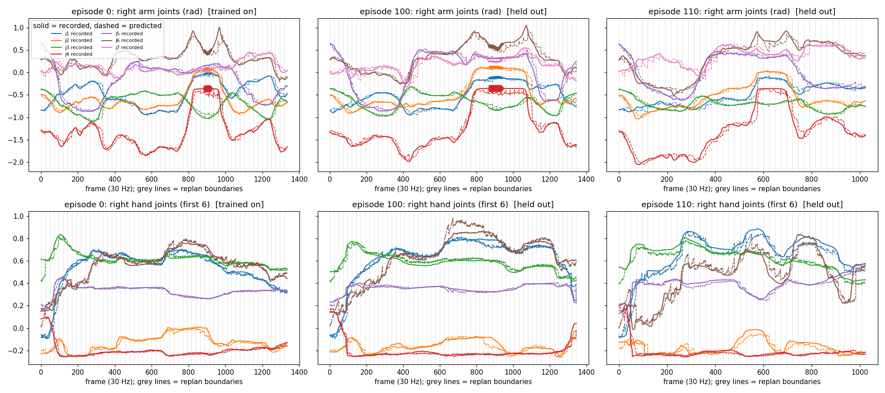

step 10000
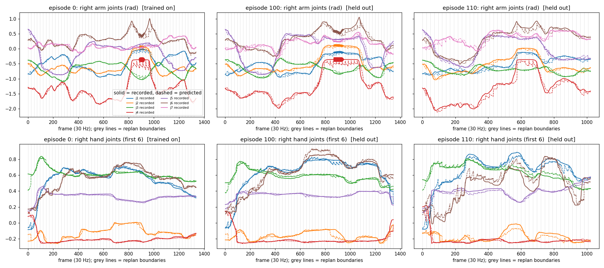

step 20000
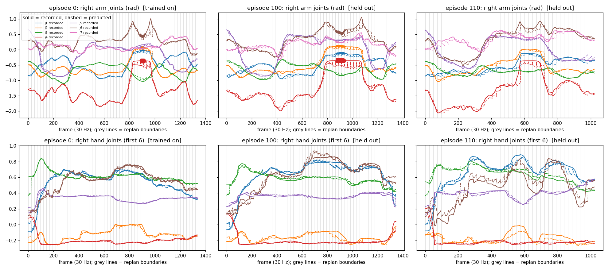

### Four checkpoints, 8 episodes (2026-10-30, later)
Added step 15000 and episodes 120, 130, 140, 150, 160 (same loop, server and metric as above), so every checkpoint has episode 0 (trained on) and 100-160 (held out, 7 episodes).
- **Step 15000:** `run_20k/step15000` downloaded from the same Hugging Face folder, stats + config copied beside it as for 5k/10k. Whole job (download, serve, replay all 8 episodes, summary): `scripts/replay_step15000_pipeline.sh`. Only the download needs the network; the server runs with `HF_HUB_OFFLINE=1`
- **Others on 120-160:** `OUT_ROOT=runs/replay_plot_more EPISODES="120 130 140 150 160" bash scripts/replay_plot_ckpts.sh <5k> <10k> <20k>`. All of it ran on a100-1 GPU 7 (UUID `GPU-b032f37b-…`), with the step-15000 server on port 8713 next to the other on 8712
- **Summary table:** `python scripts/replay_summary.py` (numpy only) writes `runs/replay_summary.md` from the saved `ep<N>.npz`

Right arm, mean |err| (rad):

| Step | Ep 0 (trained) | 100 | 110 | 120 | 130 | 140 | 150 | 160 | Held-out mean |
|---|---|---|---|---|---|---|---|---|---|
| 5000 | 0.037 | 0.047 | 0.049 | 0.044 | 0.050 | 0.057 | 0.043 | 0.045 | 0.048 |
| 10000 | 0.030 | 0.046 | 0.052 | 0.043 | 0.047 | 0.056 | 0.041 | 0.039 | 0.046 |
| 15000 | 0.026 | 0.045 | 0.052 | 0.041 | 0.046 | 0.055 | 0.040 | 0.038 | **0.045** |
| 20000 | 0.024 | 0.045 | 0.049 | 0.042 | 0.048 | 0.061 | 0.039 | 0.039 | 0.046 |

Right hand (22 joints), mean |err| (rad):

| Step | Ep 0 (trained) | 100 | 110 | 120 | 130 | 140 | 150 | 160 | Held-out mean |
|---|---|---|---|---|---|---|---|---|---|
| 5000 | 0.012 | 0.017 | 0.024 | 0.019 | 0.024 | 0.018 | 0.020 | 0.017 | 0.020 |
| 10000 | 0.009 | 0.016 | 0.022 | 0.017 | 0.023 | 0.019 | 0.022 | 0.015 | 0.019 |
| 15000 | 0.006 | 0.015 | 0.022 | 0.017 | 0.023 | 0.020 | 0.021 | 0.014 | **0.019** |
| 20000 | 0.009 | 0.017 | 0.026 | 0.020 | 0.024 | 0.022 | 0.023 | 0.016 | 0.021 |

- Held-out error is nearly flat across checkpoints (arm 0.048 / 0.046 / 0.045 / 0.046, hand 0.020 / 0.019 / 0.019 / 0.021), much smaller than the spread between episodes (140 is worst for every checkpoint)
- Step 15000 has the lowest held-out mean on both, but by ~0.001 rad, which is within noise. 10000, 15000 and 20000 cannot be separated by this replay
- Step 20000 is the only one that gets worse on held-out (hand 0.021; episode 140 arm 0.061 vs 0.055 at 15000), in line with the overfitting note
- On trained episode 0 the arm error keeps falling with training (0.037 → 0.024) and the hand is lowest at 15000 (0.006), but held-out error does not follow
- Open-loop tracking of recorded actions only: it says nothing about closed-loop success

Plots, one per episode with the four checkpoints side by side (columns = step 5000 / 10000 / 15000 / 20000; top right-arm joints 1-7, bottom first 6 right-hand joints; solid = recorded, dashed = predicted, grey lines = replan boundaries; per-panel mean |err| in the title). Regenerate with `python scripts/replay_compare_by_episode.py`.

Episode 0 (trained on):
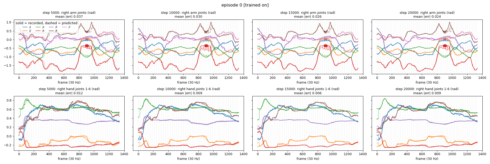

Episode 100 (held out):
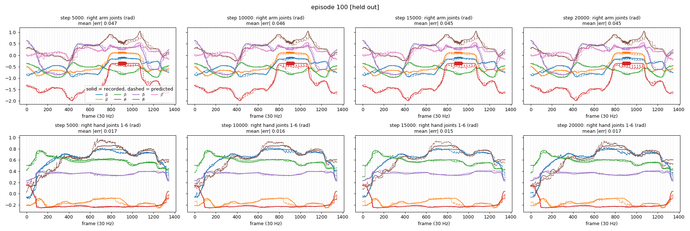

Episode 110 (held out):
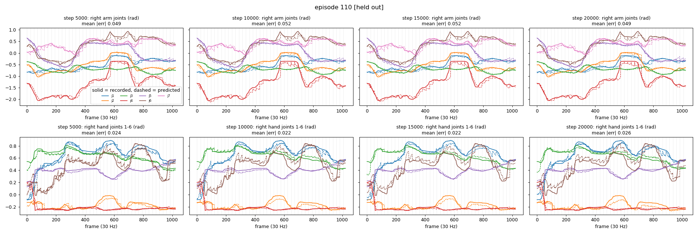

Episode 120 (held out):
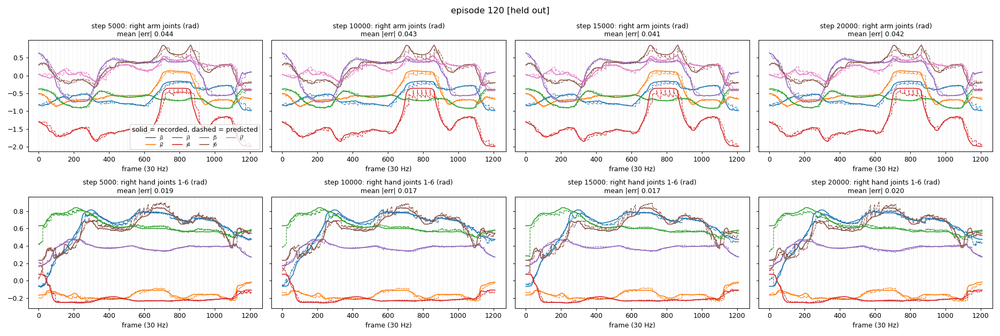

Episode 130 (held out):
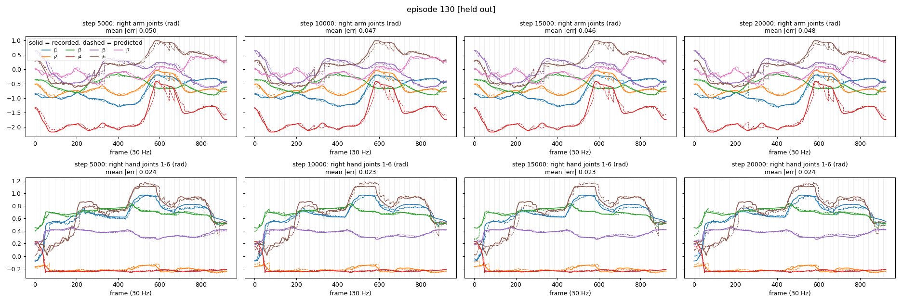

Episode 140 (held out):
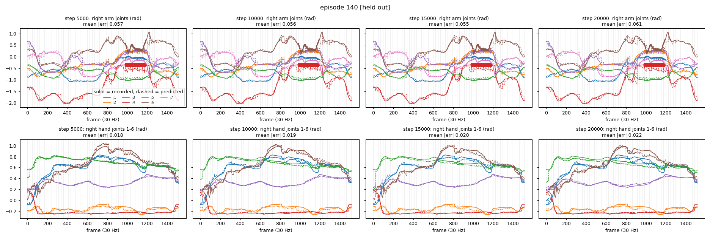

Episode 150 (held out):
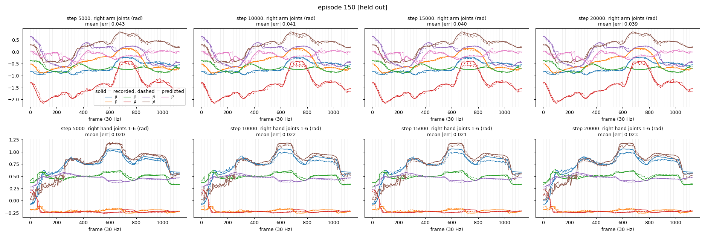

Episode 160 (held out):
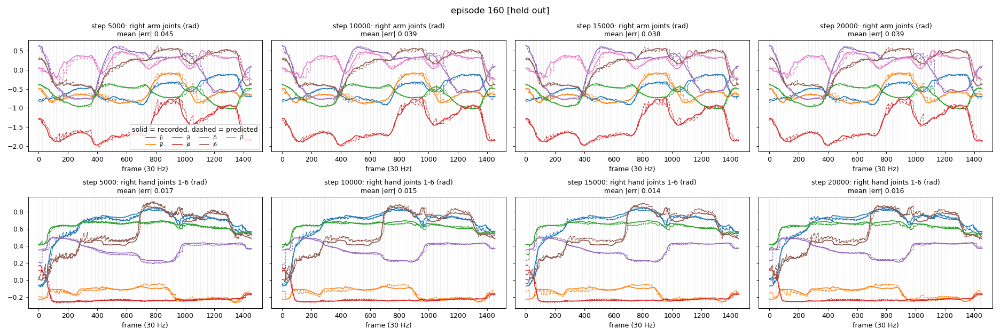

### EEF error of the replay (2026-10-31)
Same replay data (`ep<N>.npz`, predicted vs recorded 58-D rows after the server's IK), but compared in Cartesian space: both streams go through the deployment FK (`utils/vega_fk_ik/vega_kinematics.py`, torso/head as in the conversion) to the `L_ee`/`R_ee` poses in the world frame. Per frame: position error = |p_pred - p_gt| (mm); rotation error = geodesic angle between the two orientations (deg). Script: `scripts/replay_eef_error.py` (needs pinocchio, so the deploy venv; no GPU), which also writes `runs/replay_eef_summary.md`.
- The error includes the server's IK (target pose -> joints), so it is the end-to-end error of what the robot would be sent, not the model's 64-D EEF error. It is close to the earlier 64-D held-out test (R 18.3 mm / 4.8°, step 20000), as expected

Right EEF position error (mm):

| Step | Ep 0 (trained) | 100 | 110 | 120 | 130 | 140 | 150 | 160 | Held-out mean |
|---|---|---|---|---|---|---|---|---|---|
| 5000 | 14.5 | 18.1 | 21.7 | 17.3 | 20.9 | 23.4 | 18.5 | 20.3 | 20.0 |
| 10000 | 10.6 | 18.1 | 20.5 | 15.3 | 20.6 | 22.3 | 16.5 | 19.5 | 19.0 |
| 15000 | 9.2 | 17.8 | 21.3 | 15.3 | 19.7 | 22.2 | 15.5 | 18.8 | **18.6** |
| 20000 | 9.1 | 17.6 | 21.1 | 15.9 | 22.0 | 24.5 | 16.9 | 19.3 | 19.6 |

Right EEF rotation error (deg):

| Step | Ep 0 (trained) | 100 | 110 | 120 | 130 | 140 | 150 | 160 | Held-out mean |
|---|---|---|---|---|---|---|---|---|---|
| 5000 | 4.24 | 5.97 | 5.71 | 5.57 | 5.62 | 6.29 | 5.04 | 5.45 | 5.66 |
| 10000 | 2.97 | 5.31 | 5.37 | 4.77 | 5.31 | 6.00 | 4.62 | 5.10 | 5.21 |
| 15000 | 2.58 | 5.07 | 5.53 | 4.70 | 4.88 | 5.84 | 4.46 | 4.69 | **5.02** |
| 20000 | 2.45 | 4.96 | 5.29 | 4.85 | 5.54 | 5.99 | 4.90 | 5.08 | 5.23 |

Left EEF (the arm that mostly idles), held-out mean: position 7.6 / 7.6 / 7.4 / 7.6 mm and rotation 1.37 / 1.33 / 1.31 / 1.32° for steps 5000 / 10000 / 15000 / 20000 (per-episode values in `runs/replay_eef_summary.md`).

- Same picture as the joint error: step 15000 has the lowest held-out mean (R 18.6 mm / 5.02°), but 10000-20000 are within ~1 mm / 0.2° of each other, which is inside the episode-to-episode spread (episode 140 is the worst for every checkpoint, 15-24 mm). Step 5000 is clearly the worst (20.0 mm / 5.66°) and step 20000 is worse than 15000 on position (19.6 mm), again consistent with mild overfitting
- On the trained episode 0 the error keeps falling with training (14.5 → 9.1 mm, 4.24 → 2.45°); held-out does not follow
- The curves are spiky rather than a uniform offset: errors of 25-30 mm / 3-8° are typical and sharp peaks (100-150 mm, 25-30°) appear at the same moments in all four checkpoints (e.g. frame ~1090 in episode 100, ~1220 in episode 140), so they are properties of the episode (fast or ambiguous phases), not of one checkpoint. The error also rises at replan boundaries (grey lines)
- Open-loop only, one replay per checkpoint; it says nothing about closed-loop success

Curves, one figure per episode with the four checkpoints side by side (top right-EEF position error, bottom rotation error; thin = per frame, red = 1 s moving average, grey lines = replan boundaries). Regenerate with `~/venvs/agenticwam-deploy/bin/python scripts/replay_eef_error.py`.

Episode 0 (trained on):
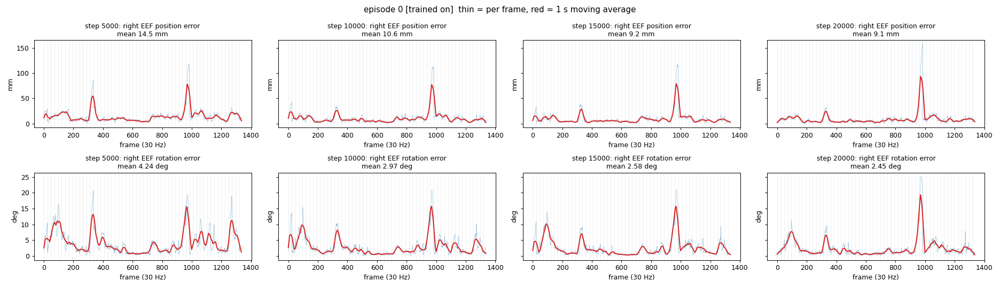

Episode 100 (held out):
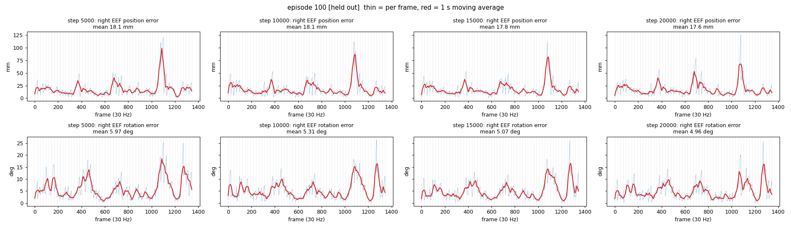

Episode 110 (held out):
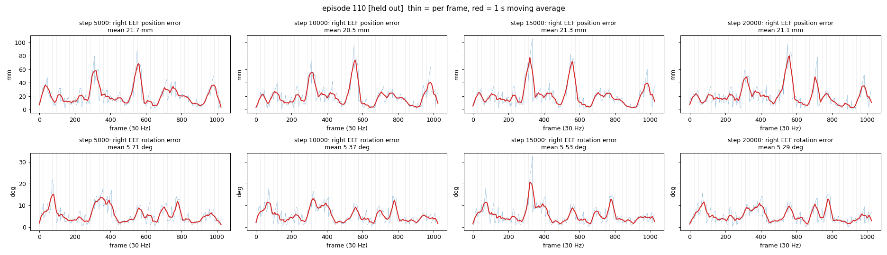

Episode 120 (held out):
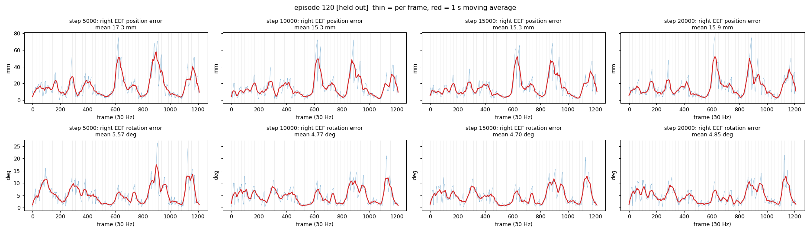

Episode 130 (held out):
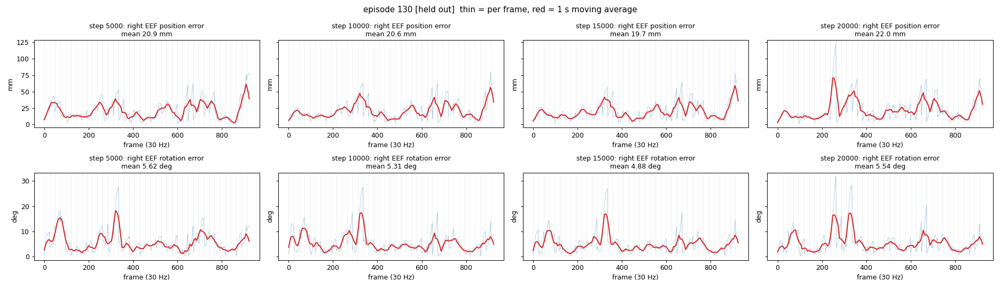

Episode 140 (held out):
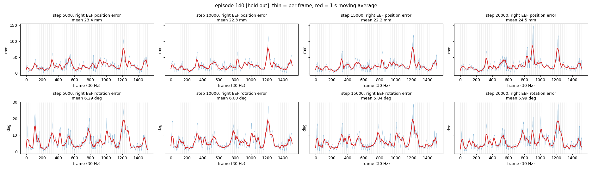

Episode 150 (held out):
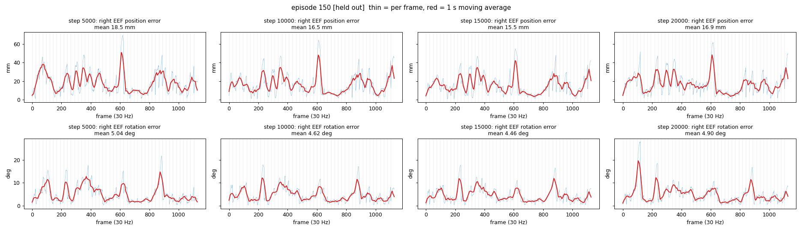

Episode 160 (held out):
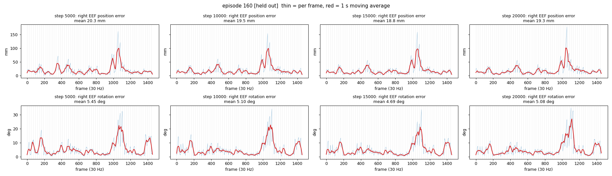
