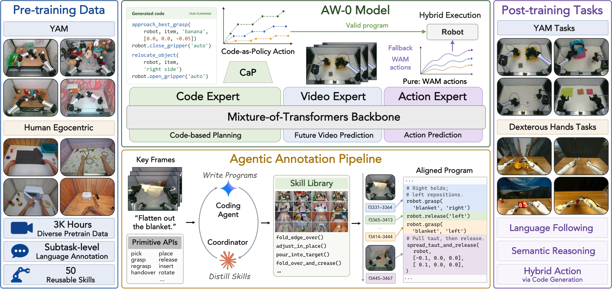

<div align="center">

# AW-0: Agentic World Action Models


[🌐 **Project Page**](https://agentic-wam.github.io/) | [✍️ **Paper (arXiv)**](#) | [🤗 **Model**](#-model-zoo) | [💻 **Code**](https://github.com/ZhuoyangLiu2005/agentic-wam)
<!-- TODO: arXiv link -->

Zhuoyang Liu<sup>1*</sup>, Dantong Niu<sup>1,2*&dagger;</sup>, Botong Zhang<sup>3*</sup>, Boning Shao<sup>1*</sup>, Jing Wang<sup>2</sup>, Ruijie Zheng<sup>2</sup>, Yuvan Sharma<sup>2</sup>, Runyu Lu<sup>2</sup>, Jiaming Liu<sup>2</sup>, Renrui Zhang<sup>3</sup>, Roei Herzig<sup>1</sup>, Yutong Bai<sup>1</sup>, Ken Goldberg<sup>1</sup>, Danfei Xu<sup>2</sup>, Yuke Zhu<sup>2&dagger;</sup>, Guanzhi Wang<sup>2&dagger;</sup>, Linxi &ldquo;Jim&rdquo; Fan<sup>2&dagger;</sup>, Trevor Darrell<sup>1&dagger;</sup>

<sup>1</sup>UC Berkeley &nbsp;&nbsp; <sup>2</sup>NVIDIA &nbsp;&nbsp; <sup>3</sup>University of Pennsylvania

<sup>*</sup>Equal Contribution &nbsp;&nbsp; <sup>&dagger;</sup>Equal Advising

</div>

<p align="center">
  
</p>

**AW-0 is an agentic World Action Model**: alongside the imagined future video and the action, it writes its plan as
a short program — and denoises all three together.

> **Abstract.** Recent world action models provide visual foresight and future prediction for robot manipulation,
> but lack explicit mechanisms for compositional skill reuse. Agentic robotics combines code-based planning and
> reasoning with reusable skills, but often lacks predictive grounding in physical dynamics.
>
> We introduce AW-0, an agentic world action model framework that integrates code-based planning with joint video and
> action prediction. We jointly model code, future video, and robot actions as three coupled generative streams within
> a unified mixture-of-transformers architecture. Within this architecture a code expert generates parameterized skill
> routines and control logic while video and action experts generate future visual states and low-level motor
> commands. Code serves two complementary roles: it structures multi-step prediction and control within the world
> model and represents skills as reusable programs for subsequent agentic execution. We further introduce an automated
> curation pipeline that labels robot and human video trajectories with aligned programs and consolidates recurring
> routines into reusable skill libraries. Evaluations on RoboTwin 2.0 and physical bimanual manipulation tasks show
> improved task performance over VLA and WAM baselines, alongside gains in language following, semantic reasoning and
> robustness, demonstrating that agentic code enables connection between planning, prediction and execution within
> WAMs.

AW-0 couples three transformer experts in one Mixture-of-Transformers with per-layer joint self-attention: a
**video world model** (Cosmos-Predict2.5-2B, Wan2.2 VAE) that imagines the future, a **code expert** (SDAR-1.7B
body) that writes the plan as a program over a skill API, and a diffusion **action head**. The program is never
executed by the policy: it is a symbolic plan that the world model and the action head attend to. This repository is
`agenticwam` — named for the model family rather than one model, so later work can build on it.

### Highlights

- **Code as the plan.** The code expert reads the observation through a frozen Qwen3-VL-2B vision tower and the
  instruction; the imagined future video reads the code; the action reads everything.
- **Joint co-denoising.** Future video, code and action are denoised together in one loop; the code canvas is
  revealed by a confidence-ordered masked decode. Autoregressive and block-diffusion code are swappable.
- **One model across embodiments.** Robot arms with grippers, dexterous hands and human hands share a unified 64-D
  action space; RoboTwin 2.0 uses its native 14-D joints.
- **Programs for every frame.** A VLM labeling pipeline turns demonstrations into per-frame programs against frozen
  skill libraries for robot grippers and human hands.
- **Full pipeline.** Pretraining (robot + egocentric human video), post-training and deployment on real robots (YAM,
  Tianji + Sharpa), and the RoboTwin 2.0 benchmark.

The model trains in two stages — large-scale **pretraining** on robot (`yam`) and egocentric human (`ego`) data →
task-specific **post-training** on a real robot or in RoboTwin. Every recipe can also run **without the code
expert** — `model.use_code_expert=false` builds the same model with the video and action experts only.

> **This repository ships the complete code**, pretraining included. We release the **pretrained checkpoint**
> (below), so you can start directly at post-training. The pretraining corpora and the Cosmos-Predict2.5-2B video
> checkpoint that pretraining starts from are not part of this release.

## 🤗 Model Zoo

| Checkpoint | Stage | Notes |
|---|---|---|
| [`miniFranka/agentic-wam-pretrain-yamego3k-soup-e1`](https://huggingface.co/miniFranka/agentic-wam-pretrain-yamego3k-soup-e1) | Pretrain | Robot (`yam`) + egocentric human (`ego`) mixture, 1 epoch. **Start here to post-train on your own task** (`paths.pretrain_ckpt`). |
| [`miniFranka/agentic-wam-posttrain-robotwin-suit`](https://huggingface.co/miniFranka/agentic-wam-posttrain-robotwin-suit) | RoboTwin SFT | WAM and hybrid, shared 14-D stats and eval assets. [Setup and evaluation](docs/ROBOTWIN.md#evaluation). |

The checkpoint holds every trained weight. The frozen public components load from their own releases: the Wan2.2
VAE ([`Wan-AI/Wan2.2-TI2V-5B`](https://huggingface.co/Wan-AI/Wan2.2-TI2V-5B)), the instruction encoder
([`nvidia/Cosmos-Reason1-7B`](https://huggingface.co/nvidia/Cosmos-Reason1-7B)), the code-expert body
([`JetLM/SDAR-1.7B-Chat`](https://huggingface.co/JetLM/SDAR-1.7B-Chat)) and the vision tower
([`Qwen/Qwen3-VL-2B-Instruct`](https://huggingface.co/Qwen/Qwen3-VL-2B-Instruct)) — [docs/INSTALL.md](docs/INSTALL.md) §3.

## 📚 Guides

| guide | covers |
|---|---|
| [docs/INSTALL.md](docs/INSTALL.md) | environment, model weights, the paths file, smoke test |
| [docs/DATA.md](docs/DATA.md) | preparing a real-robot dataset: recordings → LeRobot shards, the 64-D space, stats, instruction embeddings, checks |
| [docs/CODE_ANNOTATION.md](docs/CODE_ANNOTATION.md) | per-frame program labels: the VLM labeling pipeline, task programs, the flat code cache |
| [docs/REALWORLD.md](docs/REALWORLD.md) | post-training on YAM and Tianji + Sharpa, and running a checkpoint on YAM (model server, robot contract, evaluation) |
| [docs/ROBOTWIN.md](docs/ROBOTWIN.md) | RoboTwin 2.0: data collection with `codegen/sim`, training, the benchmark, the hybrid code × WAM evaluation |
| [docs/PRETRAINING.md](docs/PRETRAINING.md) | pretraining on the `yam` and `ego` sources: data format, preparation, code labels, configuration, launch |

## 🤖 Claude Code skills

The repository ships [Claude Code](https://claude.com/claude-code) skills in [`.claude/skills/`](.claude/README.md):
runbooks that walk an agent through each workflow with the scripts in this repository, checking the result of every
step and stopping for confirmation before anything that costs money (VLM calls) or holds GPUs for long. Start
`claude` in the repository root and ask in plain words, or call a skill by name:

| Skill | Use it to |
|---|---|
| `/agenticwam-setup` | set up a machine: environment, public weights and the AW-0 checkpoint, `configs/paths`, smoke tests |
| `/robotwin-dataprep` | turn RoboTwin data (collected with `codegen/sim`, or the official set) into a training config |
| `/pretrain-annotation` | label the `yam` / `ego` pretraining sources with per-frame code |
| `/posttrain-annotation` | label a YAM or Tianji + Sharpa dataset with per-frame code for post-training |
| `/downstream-training` | launch, monitor and resume post-training or RoboTwin training, then serve or benchmark |

```bash
cd agentic-wam && claude
> /posttrain-annotation   label /data/fold_towels (YAM) with the VLM pipeline, budget 200 episodes
```

The RoboTwin program-authoring skills (`robotwin-fix-loop`, `robotwin-evosearch`, `robotwin-collect`) are listed in
[`.claude/README.md`](.claude/README.md) and [docs/ROBOTWIN.md](docs/ROBOTWIN.md)

## Repository layout

```
agentic-wam/
├── src/agenticwam/
│   ├── models/cosmos_mot/      agenticwam_model.py (losses, masks, joint inference) · generic_mot.py (joint attention)
│   │                           code_vision.py (Qwen3-VL prefix) · build.py (model factory)
│   ├── models/cosmos/          Cosmos DiT, video tokenizer, Wan2.2 VAE, flow-matching schedulers
│   ├── models/experts/         code_expert.py (joint / blockdiff / ar) · action_dit.py · shared blocks
│   ├── datasets/lerobot/       robot_video_dataset.py · transforms/ (yam, tianji_sharpa, ego → 64-D)
│   └── trainer.py · runtime.py
├── configs/
│   ├── paths/default.yaml      every weights / data location (edit this first)
│   ├── model/                  agenticwam_cosmos.yaml — the one model config
│   ├── real_pre_train/         pretrain_magic_soup (task + data)
│   ├── real_post_train/        posttrain_yam · posttrain_sharpa (task + general data configs)
│   └── robotwin/               robotwin_wam · robotwin_hybrid, benchmark definition, WAM/hybrid eval configs
├── scripts/                    train_real_{yam,sharpa}.sh · train_robotwin.sh · launch_train.py · preflight_sft.py
│                               {pre,post}train_annotation*.sh · precompute_cosmos_text_embeds.py
├── codegen/
│   ├── pretrain/               VLM labeling engine (pipeline/) + frozen skill libraries (yam, ego)
│   ├── posttrain/              real-robot labeling tools: sub-task splits, flat caches, alignment checks
│   └── sim/                    RoboTwin program authoring + code-labeled demonstration collection
├── robotwin/                   deploy/ (the policy RoboTwin calls) · dataprep/ · eval/ (benchmark) · hybrid_eval/
├── deploy/                     real-robot model server and robot-side client
├── utils/                      dataset tools (stats, embedding checks) · yam_fk_ik/ (YAM kinematics)
├── .claude/skills/             Claude Code skills: setup, data prep, code annotation, training, RoboTwin authoring
└── docs/                       the guides above
```

## Install

```bash
conda create -n agenticwam python=3.10 -y
conda activate agenticwam
# torch first, from the CUDA-12.8 index:
pip install torch==2.7.1+cu128 torchvision==0.22.1+cu128 --extra-index-url https://download.pytorch.org/whl/cu128
# everything else (pinned in pyproject.toml; transformers>=4.57 for Qwen3-VL):
pip install -e .
```

Then download the public weights and the AW-0 checkpoint, and set their locations in
**`configs/paths/default.yaml`** — the one file that names paths on your machine (or keep a per-machine copy and pass
`paths=<name>`, or override single keys such as `paths.pretrain_ckpt=...`). [docs/INSTALL.md](docs/INSTALL.md) has the
download commands, the key list and a smoke test.

## Post-training & deployment (real robots)

Post-train the released checkpoint on your own task, then serve it on the robot.

| Step | Command | What it does |
|---|---|---|
| **Prepare data** | [docs/DATA.md](docs/DATA.md) | recordings → LeRobot shards (3 cameras, 224×320, 30 Hz) + 64-D stats + instruction embeddings |
| **Code labels** | `bash scripts/posttrain_annotation_{yam,sharpa}.sh <stage>` | per-frame programs from the VLM labeling pipeline, or your own task program ([docs/CODE_ANNOTATION.md](docs/CODE_ANNOTATION.md)) |
| **Post-train** | `bash scripts/train_real_yam.sh <dataset_dir> <code_cache.pt>` (or `train_real_sharpa.sh`) | 100k steps from the AW-0 checkpoint; runs `scripts/preflight_sft.py` first (`DRY_RUN=1` stops after the checks) |
| **Serve (YAM)** | `CKPT=/path/to/model.pt DATASET=<dataset_dir> INSTR="<instruction>" AGENTICWAM_DEPLOY_TOKEN=<token> bash deploy/launch_server.sh` | HTTP model server; the robot station sends 3 camera frames + 14-D joints and gets absolute joint targets ([docs/REALWORLD.md](docs/REALWORLD.md) §4) |

## RoboTwin 2.0

| Step | Command | What it does |
|---|---|---|
| **Train** | `bash scripts/train_robotwin.sh robotwin_wam` | 50 tasks, official demonstrations, 14-D joints (`robotwin_hybrid`: data collected with `codegen/sim`) |
| **Benchmark** | `python scripts/eval_robotwin_release.py wam` | released WAM checkpoint; every task × Easy / Hard, 100 episodes each, sharded over GPUs, resumable; start with `--tasks click_alarmclock --plan smoke --gpus 0` |
| **Hybrid eval** | `python scripts/eval_robotwin_release.py hybrid --gpus 0 --vis-gpu 1` | released hybrid checkpoint; generated code executes through cap-x when accepted, with WAM fallback; checks/starts perception servers |

[docs/ROBOTWIN.md](docs/ROBOTWIN.md) covers setup, evaluation, data collection and training.

## Pretraining

```bash
# Fit ONE normalizer jointly over the transformed training sources.
PYTHONPATH=src python utils/make_stats.py --task pretrain_magic_soup \
    data.yam_root=<yam_root> data.ego_root=<ego_root> data.shared_norm_stats=<mixture>/dataset_stats_eef64.json
python scripts/launch_train.py --task pretrain_magic_soup --nproc 8 \
    data.yam_root=<yam_root> data.ego_root=<ego_root> data.shared_norm_stats=<mixture>/dataset_stats_eef64.json
```

Two sources in a standard LeRobot layout — `yam` (robot arms + grippers, 3 cameras) and `ego` (egocentric human hands,
1 camera) — each with instruction embeddings and per-frame code labels, using one shared normalization file
computed jointly after their raw-to-64D transforms. From scratch the video expert starts
from a Cosmos-Predict2.5-2B video checkpoint (not distributed); to continue from the AW-0 checkpoint instead, add
`foundation_ckpt=<AW-0 checkpoint> model.load_pretrain=false`. [docs/PRETRAINING.md](docs/PRETRAINING.md) has the data
format, the labeling pipeline and the configuration.

## Multi-node distributed launch

Every training entry point (`scripts/train_*.sh`, `scripts/launch_train.py`) reads the rendezvous from the
environment — run the same command on every node:

```bash
export NNODES=4                     # total nodes
export NODE_RANK=0                  # 0 on the master, 1, 2, ... on the others
export MASTER_ADDR=<rank-0 host>
export MASTER_PORT=29500
export RUN_ID=<run name>            # the same on every node: one run directory, and resumable
```

`--nproc` / `NPROC` sets the GPUs per node (8). Effective batch = `batch_size × gradient_accumulation_steps × GPUs`.
DeepSpeed ZeRO-1 by default (`ZERO=2` for ZeRO-2). [docs/PRETRAINING.md](docs/PRETRAINING.md) §4.

## Logging

Training logs to W&B (`configs/train.yaml`, project `agenticwam`). Export `WANDB_API_KEY` (never put it in a script
or config), or pass `wandb.enabled=false` / set `WANDB_MODE=offline`.

## License

Released under the **BSD 2-Clause License** — see [`LICENSE`](LICENSE). The public models listed in the Model Zoo keep
their own licenses.

## Citation

If you find AW-0 useful, please cite:

```bibtex
@misc{aw0_2026,
  title={Agentic World Action Models},
  author={Zhuoyang Liu and Dantong Niu and Botong Zhang and Boning Shao and Jing Wang and Ruijie Zheng and Yuvan Sharma and Runyu Lu and Jiaming Liu and Renrui Zhang and Roei Herzig and Yutong Bai and Ken Goldberg and Danfei Xu and Yuke Zhu and Guanzhi Wang and Linxi Fan and Trevor Darrell},
  year={2026},
  url={https://agentic-wam.github.io/},
}
```
<!-- TODO: add the arXiv id (eprint / archivePrefix / primaryClass) once posted. -->

## Acknowledgements

Built on NVIDIA Cosmos-Predict2.5 and Cosmos-Reason1, Wan2.2, SDAR, Qwen3-VL, LeRobot and RoboTwin 2.0.
